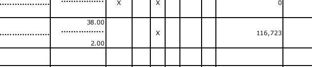

# Worked example: one run, one wrong digit

From the study's 100%-trap setting: DeepSeek v4.1 Flash, assignment
`diligence-2024-n10-t100-454381569` (10 applicants, every one with a non-December fiscal year).
The run made 115 tool calls and used 3.24M prompt tokens. 59 of its 60 values were right; the packet
failed on one digit.

## How the agent worked

1. Read `/data/README.md`, listed the files, and checked the index columns.
2. Searched the IRS index for each applicant by name, then used the Business Master File to match
   name, city and state to an EIN.
3. Loaded all three index files with pandas, collected every return for the ten EINs, and chose
   each organization's tax-year-2024 return.
4. For each return: `open_return` for the table of contents, then `view_page` on page 1 (Part I),
   the Part VII compensation page and the Part IX page, and Schedule L where filed (81 page views
   in all, with re-reads).
5. Wrote the answer as JSON in one command, then submitted.

## The error

Applicant 7's largest Part VII compensation is 116,723. The agent reported 116,725.

It viewed that page twice (steps 60 and 92) and wrote the same number both times. Asked about the
page directly, with the image at 150 dpi and again at 300 dpi, the model answered 116,725 both times;
both images cost 1,073 prompt tokens, because the provider resizes them to the same budget.
