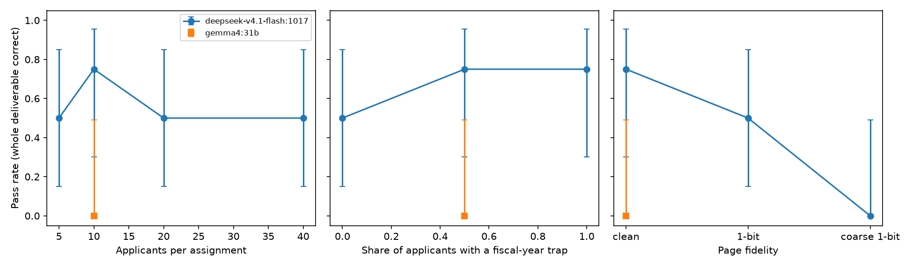

# How reliable are AI agents at nonprofit due diligence from IRS filings?

A study with 990bench, October 2026. All numbers below come from runs in this repository; the
per-run trajectories are kept under `runs/` (not committed) and summarized in
[study-results.md](study-results.md).

## Summary

- **Single values are nearly always right; whole deliverables often are not.** A cheap current
  model (DeepSeek v4.1 Flash) read at least 98.3% of graded values correctly in every run that
  finished, yet delivered a fully correct due-diligence packet in only 16 of 32 runs. One wrong
  number in 60 or 240 is enough to fail a packet, and that is the standard a real analyst is held to.
- **The errors are specific, rare in isolation, and not about resolution.** Finished-run errors
  were digit misreads in dense tables (a 3 read as 5, a 9 as 5), the prior-year column read instead
  of the current year, and one Schedule L judgment. Asked to read 193 single values from dense
  tables outside an agent run, the same model got 99.0–100% right whether it saw the full page at
  150 dpi, the full page at 300 dpi or a zoomed strip of the row, with no significant difference.
  Submitted packets fail because rare per-value errors compound over 60–240 values, not because the
  pages are too low-resolution to read.
- **Wording decided a quarter of the outcome.** With the prompt asking for "tax year 2024", two
  of four runs chose the return ending in 2024 (tax year 2023) for every organization with a
  non-December fiscal year: 10 wrong returns. Defining the term in one sentence removed every one
  of those errors on the same assignments.
- **Poor page images cost tokens before they cost accuracy.** On coarse 1-bit pages the model never
  submitted a wrong value; it exhausted its token budget in all four runs, re-reading pages.
- **A small open model is far behind.** Gemma 4 31B passed 0 of 4 baseline packets and got 66% of
  values right in the runs it finished.
- **Four runs per setting cannot resolve trends.** The intervals below overlap almost everywhere;
  horizon length and trap share show no detectable effect at this sample size.

## The task

The agent gets a short request in an analyst's words: a list of grant applicants by name, city and
state, and six facts to report for each from its tax-year-2024 Form 990: EIN, tax-period end,
total revenue (Part I line 12), program-expense share (Part IX line 25, column B over column A),
largest Part VII compensation, and whether Schedule L reports any insider transaction. It works on
a sandboxed Linux workstation with no network, the IRS's index files and Business Master File as
CSVs, and two document tools: `open_return` (a return's pages and which form or schedule each
belongs to) and `view_page` (one page as an image). Returns exist only as page images, rendered
from the IRS XML with the IRS's own display stylesheets. The deliverable is a JSON file; it passes
only if every value is right.

Example page (clean rendering) and a Schedule I continuation page are in
[render-samples/](render-samples/).

## Why the answers can be trusted

- Every answer is computed from the IRS XML by code, then recomputed by a second, independent
  route (the IRS index CSVs and direct XPath on the XML). All 24 study assignments agree.
- Every value an answer depends on was confirmed to be printed on the rendered pages.
- Generators only choose organizations whose identity is unambiguous (name, city and state unique
  across 1.85 million returns and the Business Master File), with exactly one original return for
  the year, no amendments, and no percentage within 0.001 points of a rounding boundary.
- Every failed run was audited by comparing the submitted value with the page. The one ambiguity
  found (the meaning of "tax year") was fixed in the prompt and the affected runs repeated; the
  original runs are reported as an ablation below.

## Study design

One assignment family, three dials varied one at a time around a baseline of 10 applicants, half
with a fiscal-year trap, on clean pages:

| Dial | Settings |
| --- | --- |
| Horizon | 5, 10, 20, 40 applicants |
| Fiscal-year traps | 0%, 50%, 100% of applicants (a trap: a non-December fiscal year whose previous return also ends in 2024) |
| Page fidelity | clean grayscale at 150 dpi; 1-bit at 150 dpi, like the IRS's published images; coarse 1-bit at 100 dpi |

Four validated assignments per setting; the fidelity settings reuse the baseline assignments.
Every run used the same harness: the six most recent page images stay in context and older ones
are replaced by a note, so long assignments test note-keeping rather than context size; a run
stops as a failure when its cumulative prompt tokens pass 400,000 per applicant (about three times
the median passing baseline run). Runs stopped by the provider's quota were excluded and rerun.

## Results

| Model | Setting | Runs | Passed | Wrong values | Stopped by budget | Pass rate (95% CI) | Value accuracy, finished runs | Mean tool calls | Mean prompt tokens |
| --- | --- | --- | --- | --- | --- | --- | --- | --- | --- |
| DeepSeek v4.1 Flash | 10 applicants, 50% traps, clean (baseline) | 4 | 3 | 1 | 0 | 75% (30–95%) | 99.6% | 106 | 2.36M |
| DeepSeek v4.1 Flash | 5 applicants | 4 | 2 | 0 | 2 | 50% (15–85%) | 100.0% | 82 | 1.57M |
| DeepSeek v4.1 Flash | 20 applicants | 4 | 2 | 2 | 0 | 50% (15–85%) | 99.6% | 187 | 3.61M |
| DeepSeek v4.1 Flash | 40 applicants | 4 | 2 | 2 | 0 | 50% (15–85%) | 99.8% | 254 | 5.62M |
| DeepSeek v4.1 Flash | 0% traps | 4 | 2 | 1 | 1 | 50% (15–85%) | 99.4% | 110 | 2.70M |
| DeepSeek v4.1 Flash | 100% traps | 4 | 3 | 1 | 0 | 75% (30–95%) | 99.6% | 108 | 2.61M |
| DeepSeek v4.1 Flash | 1-bit pages | 4 | 2 | 0 | 2 | 50% (15–85%) | 100.0% | 168 | 3.28M |
| DeepSeek v4.1 Flash | coarse 1-bit pages | 4 | 0 | 0 | 4 | 0% (0–49%) | n/a | 98 | 4.03M |
| Gemma 4 31B | baseline | 4 | 0 | 2 | 2 | 0% (0–49%) | 65.9% | 134 | 2.86M |

### What went wrong in finished runs

| Model | Error | Wrong applicants |
| --- | --- | --- |
| DeepSeek v4.1 Flash | Part VII compensation, digits misread (116,723 → 116,725; 28,523 → 28,525; 305,229 → 305,225) | 3 |
| DeepSeek v4.1 Flash | Total revenue taken from the prior-year column where the current year is 0 | 2 |
| DeepSeek v4.1 Flash | Total revenue, digits misread (21,149,623 → 21,149,633) | 1 |
| DeepSeek v4.1 Flash | Schedule L transaction missed | 1 |
| Gemma 4 31B | Total revenue wrong (wrong line or value) | 14 |
| Gemma 4 31B | Other fields | 5 |

The first misread, as the model saw it ([crop](render-samples/misread-116723.png)): the value is
printed clearly; the model reported 116,725, and reported the same number when the page was sent
at 300 dpi instead of 150 (both images cost 1,073 prompt tokens, so the provider downsamples them
to the same size).

### Follow-up: is image resolution the cause?

If misreads came from the provider shrinking whole pages, showing the model a zoomed strip of the
row should fix them. Before building a zoom tool, I tested that directly: values from dense tables
(Part VII compensation, Schedule J base pay, Schedule I grants), each shown three ways, the model
asked to transcribe every number in the named row ([probe-results.md](probe-results.md)).

| How the value was shown (same 193 values) | Read correctly (95% CI) | Prompt tokens per image |
| --- | --- | --- |
| Full page, 150 dpi | 191/193, 99.0% (96.3–99.7%) | 1,075 |
| Full page, 300 dpi | 193/193, 100.0% (98.0–100.0%) | 1,075 |
| Strip around the row, 300 dpi | 192/193, 99.5% (97.1–99.9%) | 677 |

Paired exact McNemar tests: full page vs strip, 1 vs 2 discordant values (p = 1); 150 vs 300 dpi,
0 vs 2 (p = 0.5). The run was stopped at 193 of 401 planned values because the answer was already
clear: there is no room for zoom to help, so the zoom tool I had drafted was removed from the harness.

### Ablation: one undefined term

Same four baseline assignments, same model, before and after adding "Tax year 2024 means the 2024
Form 990, which covers a tax year beginning in 2024":

| Prompt | Passed | Wrong returns chosen |
| --- | --- | --- |
| "tax year 2024" undefined | 2/4 | 10 (every trap applicant in the two failed runs) |
| defined | 3/4 | 0 |

## Limitations

- Four runs per setting. A 95% interval on a pass rate from four runs spans about 70 points;
  narrowing it to about ±15 points takes roughly 40 runs per setting.
- One cheap model across all settings, one weak model at one setting, and no strong model. The
  provider's 5-hour quota made strong-model runs impractical, so none were measured.
- The token budget stopped 9 of 32 DeepSeek runs and 2 of 4 Gemma runs. A larger budget would
  turn some of those into passes or wrong answers. The budget is part of the task definition and
  applied identically to every model. One baseline run made before the budget existed looped for
  26.7M prompt tokens without submitting; it was rerun under the budget.
- One assignment family. The repository also contains follow-the-money, compensation-ranking,
  grant-ledger and Schedule J transcription assignments, which the cheap model passed in single
  runs (see the [appendix](appendix.md)).

## Reproduce

See the [README](../README.md): fetch the IRS data, build the catalog and fact tables, then
`python -m bench990.study plan`, `python -m bench990.study run --model …`, and
`python -m bench990.analysis`.
